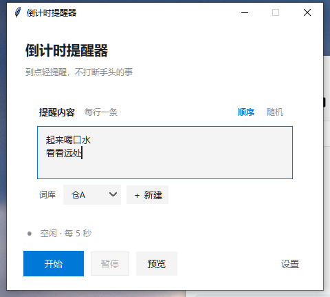
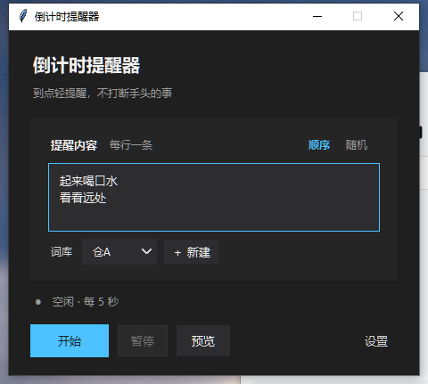

# TimeNote · 倒计时提醒器

一个只在 Windows 上运行的轻量倒计时提醒器：到点弹一个不抢焦点的小卡片，提醒你喝水、起身、看远处。

界面尽量克制，主界面只保留内容、词库、开始/暂停、预览和设置。



## 下载

| 文件 | 说明 |
|---|---|
| [CountdownReminder.exe](https://github.com/387wsx/TimeNote/raw/main/CountdownReminder.exe) | Windows 10/11 64 位，单文件，约 11.7 MB |
| [源代码](reminder_improved.py) | Python 3.10+ / tkinter，无第三方运行时依赖 |

第一次运行如果弹出 SmartScreen，点“更多信息 → 仍要运行”即可；exe 没有代码签名。

> 关闭窗口默认**收进托盘**，不是退出。托盘右键菜单里选「退出」才真正结束进程。  
> 不习惯的话：设置 → 系统 → 关闭「关闭到托盘」。

## 功能

- **多词库**：仓 A / 仓 B 独立保存词条、顺序/随机方式和轮换进度
- **计划**：每隔 N 秒，或每天固定时刻；支持星期和活跃时段
- **全屏延后**：游戏/会议全屏时先不弹，退出全屏再提醒
- **轻提示音**：柔和 / 清脆 / 木质三档，可关闭
- **随机不重复**：随机模式一轮内不重复，抽完再洗牌
- **暂停/稍后/跳过**：主界面暂停 30 分钟；弹窗右键稍后、跳过、停止
- **外观**：字体、字号、文字颜色、弹窗底色、位置、窗口大小
- **深色模式**：主窗、设置、词库管理、标题栏一起切换
- **系统**：开机自启、全局热键、关闭到托盘
- **单文件配置**：`%USERPROFILE%\.countdown_reminder.json`，升级不丢词



## 使用

1. 双击 `CountdownReminder.exe`；
2. 在「提醒内容」里每行写一条词；
3. 用 `＋ 新建` 建仓，`仓A ▾` 切换；
4. 点「开始」，窗口会收起来，到点弹卡片；
5. 设置 → 提醒，切换「间隔 / 定时」、星期、活跃时段；
6. 设置 → 外观，切换浅色/深色和弹窗样式。

弹窗上：

- 左键：收起，进入下一轮
- 右键：稍后 N 分钟 / 跳过本次 / 停止

托盘图标：

- 双击：恢复主窗口
- 右键：显示窗口 / 开始或停止 / 暂停或继续 / 退出

## 全局热键

默认开启：

- `Ctrl + Alt + R`：开始 / 停止
- `Ctrl + Alt + P`：暂停 / 继续

可在设置 → 系统关闭。

## 配置文件

```
%USERPROFILE%\.countdown_reminder.json
```

包含词库、计划、外观和系统设置。日志：

```
%USERPROFILE%\.countdown_reminder.log
```

换电脑时把 json 一起复制过去即可带走词库。

## 从源码运行

需要 Python 3.10+，只用标准库：

```bat
python reminder_improved.py
```

## 打包 EXE

```bat
python -m pip install -r requirements-build.txt
build.bat
```

产物：`dist\CountdownReminder.exe`。

构建使用 Python 3.12 + PyInstaller 6.22，单文件、无控制台、带图标和版本信息。

## 项目结构

```
reminder_improved.py       主程序（tkinter，单文件）
app.ico                    应用图标（多尺寸 ico）
version.txt                Windows 版本信息
build.bat                  PyInstaller 构建脚本
CountdownReminder.spec     PyInstaller 配置
requirements-build.txt     构建依赖
docs/                      README 截图
```

## 已知限制

- 仅支持 Windows；Android 版计划用 Flutter 单独实现。
- 单文件版首次启动会解压到临时目录，慢 1–2 秒。
- 未做代码签名，公开分发可能触发 SmartScreen。
- 数据只存在本机，没有云同步。

## License

[MIT](LICENSE)
